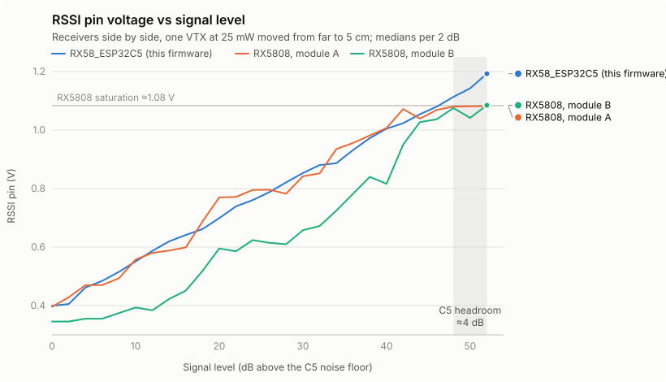

# RX58_ESP32C5: an RX5808 replacement on a XIAO ESP32-C5

Firmware that turns a **Seeed Studio XIAO ESP32-C5** into a drop-in
replacement for the **RX5808** 5.8 GHz FPV receiver module, plus a
**multi-channel mode** that measures up to **8 channels at once** (about
1,000 readings per second each) from one receiver.

- **Legacy hosts need no changes.** The C5 speaks the RX5808's 3-wire bus
  and drives an analog RSSI pin; an unmodified FPVRaceOne tunes it and times
  laps with it.
- **New hosts get more:** register read-back, digital RSSI in 1/16 dB,
  per-channel peak-hold with timestamps, and up to 4 MHz readout over the
  same three wires.

The host interface is specified in the
**[RX58_ESP32C5 SPI Interface datasheet](docs/RX58_ESP32C5_SPI_Interface.md)**
(CC BY 4.0, so hosts under any license can implement it). This README
covers the hardware, flashing, and how to integrate a host. The same
documentation is also on the [wiki](https://github.com/ramiss/RX58_ESP32C5/wiki).

> **Status: pre-release (firmware 0.1, interface v0.9.8).** RX5808 mode,
> multi-channel mode and the bus extension are implemented and bench-tested
> (see [What's verified](#whats-verified)), and the RSSI pin is matched to
> real RX5808 modules ([RSSI curve](#rssi-curve)). Composite video is
> planned (video mode) but not implemented yet.

---

## At a glance

| | |
|---|---|
| Board | Seeed Studio XIAO ESP32-C5 with its U.FL antenna (no other RF parts; lap timers may leave the antenna off) |
| Host interface | RX5808 / RTC6715 3-wire bus (DATA, SELECT, CLOCK), LSB first, 25-bit frames |
| Bus speed | Any host speed up to **4 MHz** (writes and fast readout) |
| Frequencies | 5645-5945 MHz (R1-R8 received; tuning checked up to E8 = 5945); 5180-5644 tunable, not verified |
| Tuning | RX5808 register 0x01, same formula and 2 MHz step |
| RSSI output | Analog pin on a real RX5808's curve: ~0.4 V with no signal, ~15 mV/dB, ~1.08 V where an RX5808 saturates, then ~4 dB more up to ~1.19 V ([RSSI curve](#rssi-curve)) |
| RSSI rate, RX5808 mode | ~4,900 readings/s; valid ~0.35 ms after a retune (RX5808 spec: 35 ms) |
| Multi-channel mode | Up to 8 channels, ~1,050 readings/s each, worst gap ~1.1 ms |
| Digital RSSI | 1/16 dB, peak-hold per channel with the time of the peak |
| Register read-back | Yes (RotorHazard's register check passes) |
| Boot | Bus accepts frames 51 ms after power-on |
| Supply | 5 V on the 5V pin, or USB-C |
| Logic | **3.3 V, not 5 V tolerant** (level-shift 5 V hosts) |
| Video | Planned (video mode); not in this firmware |
| Audio | No |

---

## Hardware

### What you need

- A **Seeed Studio XIAO ESP32-C5**, normally **with its antenna** plugged
  into the U.FL socket (the small FPC antenna the board ships with). The
  antenna gives RX5808 sensitivity; without it the C5 is 30-40 dB less
  sensitive, which a lap timer can use on purpose (see
  [Lap timers: antenna or no antenna](#lap-timers-antenna-or-no-antenna)).
- For the analog RSSI pin: **3 resistors and 2 capacitors** (below).
- Recommended: a **330 Ω resistor in series with DATA**.

### Pinout

| RX5808 pin | Function | XIAO ESP32-C5 pin | Notes |
|---|---|---|---|
| CH1 | SPI DATA | **D10** (GPIO10) | Bidirectional (the C5 drives it only during read frames) |
| CH2 | SPI SELECT | **D8** (GPIO8) | Input, active low |
| CH3 | SPI CLOCK | **D1** (GPIO0) | Input |
| RSSI | Analog RSSI | **D0** (GPIO1) | PWM: needs the RC filter below |
| +5V | Supply | **5V** | Or power from USB-C |
| GND | Ground | **GND** | Common with the host |
| VIDEO | Composite video | (D3-D7, D9: future video ladder) | Not in this firmware |
| A6.5M | Audio | - | Not provided |

**Leave unconnected:** D2 and the back pads GPIO2-5 and GPIO26-28 are
reserved for the video mode's internal I/Q loopback lanes (anything attached
there will corrupt video later). D3-D7 and D9 are reserved for the video
ladder.

### RSSI filter

The C5 has no DAC, so RSSI is a 78 kHz PWM on D0, filtered in two stages.
Stage 1 also divides 3.3 V down to a 1.32 V full scale: room for the RX5808
curve (up to ~1.08 V) plus the C5's headroom above it.

```
 XIAO C5                                                  Host
  D0 ──[ R1 1.5 kΩ ]──●──[ R3 1 kΩ ]──●──────────────────► RSSI input
                      │ A             │ B
                 ┌────┴────┐          │
               R2 1 kΩ   C1 220 nF   C2 100 nF
                 │         │          │
  GND ───────────┴─────────┴──────────┴──────────────────► GND
```

| Part | Value | Between |
|---|---|---|
| R1 | 1.5 kΩ (brown-green-red; or two 3 kΩ in parallel) | D0 and node A |
| R2 | 1 kΩ | node A and GND |
| C1 | 220 nF (0.22 µF, "224"), ceramic/film | node A and GND |
| R3 | 1 kΩ | node A and node B |
| C2 | 100 nF (0.1 µF, "104"), ceramic/film | node B and GND |

Measured: output within 10 mV of the design from 0 to 1.31 V, settled
within 50 ms, source impedance ~1.6 kΩ (a host's 100 kΩ pulldown, as on
FPVRaceOne, lowers it ~1.6%). Check the values: µF capacitors give the
right voltage but respond ~1000x too slowly, and a 1.5 Ω resistor in place
of 1.5 kΩ removes the divider.

### RSSI curve

The RSSI pin follows a real RX5808: measured against two RX5808 modules
side by side with the C5 (on its antenna), one VTX at 25 mW moved from far
away to 5 cm.

<picture>
  <source media="(prefers-color-scheme: dark)" srcset="docs/images/rssi_curve_dark.svg">
  
</picture>

| Signal (dB above the noise floor) | C5 RSSI pin | RX5808 module A | RX5808 module B |
|---|---|---|---|
| 0 (no signal) | 0.40 V | 0.40 V | 0.35 V |
| 10 | 0.55 V | 0.56 V | 0.39 V |
| 20 | 0.70 V | 0.77 V | 0.60 V |
| 30 | 0.85 V | 0.84 V | 0.66 V |
| 40 | 1.01 V | 1.01 V | 0.82 V |
| 48 | 1.11 V | 1.08 V (saturated) | 1.08 V (saturated) |
| 52 (C5 clips) | 1.19 V | 1.08 V | 1.09 V |

- **Linear in dB** like the RX5808's log detector: ~0.37-0.40 V with no
  signal, ~15 mV/dB. The two real modules differ by up to ~150 mV from each
  other (module spread); the C5 sits within that spread.
- **Headroom:** both RX5808s saturate at ~1.08 V; the C5 keeps resolving
  ~4 dB more. Near the gate a host sees a peak instead of a flat plateau,
  which matters to lap timers that stamp the first sample of the maximum.
- **Gain-independent:** the curve is referred to the receiver input, so a
  host's EXT GAIN does not shift it. Hosts calibrate thresholds per receiver
  as they do with an RX5808.

### Example: FPVRaceOne on a XIAO ESP32-C6

| Signal | XIAO C6 (FPVRaceOne) | XIAO C5 |
|---|---|---|
| DATA | D10 | D10 |
| SELECT | D1 | D8 |
| CLOCK | D8 | D1 |
| RSSI | D2 / A2 | D0, through the RC filter |
| GND | GND | GND |

---

## Flashing

Each [release](https://github.com/ramiss/RX58_ESP32C5/releases) carries
`RX58_ESP32C5-merged.bin`: bootloader, partition table and app in one file,
flashed at offset 0 (a local build's `firmware.factory.bin` is the same
thing).

**Windows:** download the
[RX58_ESP32C5 Flasher](https://github.com/ramiss/RX58_ESP32C5-Flasher/releases/latest/download/RX58_ESP32C5-Flasher.exe),
a portable app that flashes any release straight from GitHub (or a local
`.bin`). A new board needs BOOT held while plugging it in the first time; a
running receiver is updated without touching it.

**Any platform, with [esptool](https://github.com/espressif/esptool) 5:**

1. Unplug the XIAO, hold **BOOT**, plug it in, release BOOT.
2. Flash:
   ```
   esptool --chip esp32c5 --port COM7 --before no-reset --after no-reset write-flash 0x0 RX58_ESP32C5-merged.bin
   ```
3. Unplug and replug (or press RESET) to start the firmware.

**Updating a running receiver:** send the single character `B` on its USB
serial port; it reboots into the ROM loader ("download_boot=requested"),
then flash as in step 2. `.\tools\pio.ps1 run -t upload` does all of this
for you.

> **Don't let esptool reset a running receiver.** With this firmware
> running, esptool's default DTR/RTS reset leaves the XIAO's USB dead until
> it is unplugged. Always pass `--before no-reset` (enter the loader with
> `B` or the BOOT button instead), and open the serial port with DTR and
> RTS low.

---

## Using it from a host

### Legacy hosts (no changes)

The receiver behaves like an RX5808 in SPI mode:

- **Tune:** write register 0x01 = `(N << 7) | A` with `tf = (MHz - 479) / 2`,
  `N = tf / 32`, `A = tf % 32` (R counter 0x00 = 8, the default).
- **Power down:** write 0x0A = 0xFFFFF (all ones). Any other value keeps it
  on, including the values hosts write to disable unused blocks.
- **Wake / reset:** write 0x0F (any data).
- **RSSI:** the analog pin, valid well within the 35 ms hosts already wait.
- **Read-back:** a read of any register returns what was written, so
  RotorHazard's tuning check passes. A real RX5808 doesn't answer reads.

Frames of 25 to 32 clocks are accepted at any speed up to 4 MHz;
back-to-back frames with only 1.5 µs between them are fine. Several
receivers can share DATA and CLOCK with separate SELECT lines.

### Extension-aware hosts (multi-channel)

Every power-on starts in RX5808 mode. A host that wants more:

1. **Detect:** read register 0x0E. **0xC5009** means an RX58_ESP32C5 (protocol
   0.9); a real RX5808 reads 0xFFFFF through a pull-up.
2. **Switch mode:** EXT write MODE = 1 (register 0x0E, data `0x00001`). The
   switch happens in place in under 1 ms; confirm it by reading the INFO
   block (mode byte = 1, "switching" flag clear).
3. **Set channels:** EXT writes SLOT1..SLOT8 = frequency in MHz (data
   `(slot << 16) | MHz`; 0 = slot off).
4. **Poll** every 5-10 ms: request the PEAKS block (EXT READ_SELECT = 1),
   wait 50 µs, then clock out 10 + 6 × slots + 2 bytes in the next frame,
   with DATA as an input. Check the CRC-16.
5. **Time laps:** for each slot, the peak happened `age_us` before the
   request frame's SELECT rose. Feed `(peak, t_request - age_us)` to the
   lap logic.

```c
// Sketch (host side). ext(sub, value) = write register 0x0E, (sub << 16) | value.
if (rx_read(0x0E) == 0xC5009) {
    ext(0x0, 1);                                   // MODE = multi-channel
    for (int s = 0; s < 8; ++s) ext(0x1 + s, raceband[s]);
    for (;;) {                                     // every 5-10 ms
        ext(0xB, 1);                               // READ_SELECT = PEAKS
        uint32_t t_req = micros();                 // when SELECT rose
        delay_us(50);
        read_block(buf, 10 + 6 * 8 + 2);           // next frame, DATA as input
        if (!crc_ok(buf)) { ext(0xB, 0x81); read_block(...); }   // re-read same snapshot
        for each slot k: lap_sample(k, peak[k], t_req - age_us[k]);
    }
}
```

RSSI values are unsigned 16-bit in 1/16 dB (= 16 × (dBFS + 100) in this
firmware); compare them between slots of one receiver, and calibrate
thresholds per receiver as with an RX5808.

Everything else (block layouts, timing, the EXT sub-registers, gain and
smoothing options, re-arm for retries, power-on defaults, what happens after
a receiver restart) is in the
**[datasheet](docs/RX58_ESP32C5_SPI_Interface.md)**.

---

## Lap timers: antenna or no antenna

The antenna decides how far out the receiver starts to see a quad. Both
setups use the same firmware and settings (default gain 51); only the
host's thresholds differ.

| | With the antenna | Without the antenna |
|---|---|---|
| Sensitivity | Like an RX5808 | 30-40 dB lower |
| Sees a 25 mW quad from | Across a house, like an RX5808 | About 1-2 m |
| Near the gate | Rises ~4 dB past where an RX5808 flattens out | Still rising at the gate: the peak is the pass |
| Best for | Drop-in RX5808 behaviour, wide gates, scanners | Gates the quads fly within ~1-2 m of; ignoring quads elsewhere |

Bench measurement, one 25 mW VTX held at a series of distances, the
receivers side by side (RSSI-pin voltages; the antenna-less column is
computed from the measured level with the current curve):

| VTX position | RX5808 (FPVScanner, with antenna) | C5 with antenna | C5 without antenna |
|---|---|---|---|
| Another room | 0.41-0.50 V | 0.51 V | 0.37 V (no signal) |
| Half way | 0.70-0.85 V | 0.65-0.82 V | 0.37 V (no signal) |
| About 1-2 m | 1.0-1.08 V (saturating) | 1.06-1.19 V | ~0.56 V |
| About 5 cm | 1.08 V (saturated) | 1.19 V (clipped) | ~0.80-0.85 V |

**Why a lap timer might leave it off.** An RX5808 at race power
saturates metres before the gate, so its RSSI is flat across the pass;
a timer that stamps the first sample of the maximum (FPVRaceOne, for
example) then stamps early by about half the plateau. Without the antenna
the C5 is still climbing as the quad goes through, so the maximum is the
pass itself, and quads in the pits or across the field stay at the floor.

**What changes for the host:**
- **Lower thresholds.** The swing is smaller: from ~0.37 V to ~0.85 V at
  25 mW (more at higher VTX power; at 600 mW it reaches the top of the
  range within ~5 cm). Run the host's calibration (FPVRaceOne's
  calibration wizard, RotorHazard's enter/exit tuning) with the antenna
  off.
- **Gate geometry.** The quads must pass within about 1-2 m of the
  receiver at 25 mW; mount it at the gate, close to the flight line.
- Everything else is unchanged: tuning, both modes, the bus extension.

These are bench numbers from one VTX in one house; the exact distances
depend on VTX power, antenna orientation and the gate. Track tests (and
near/far with several quads) are still to come.

---

## Behaviour reference

| | |
|---|---|
| Power-on | RX5808 mode, 5865 MHz (register 0x01 default), gain 51, smoothing on, all registers at RTC6715 defaults; nothing is kept across power cycles |
| Modes | 0 = RX5808 (one channel), 1 = multi-channel (up to 8 slots), 2 = video (not implemented: the request is ignored) |
| Mode switch | In place, no restart: applied in 0.03-0.8 ms |
| RSSI pin | The RX5808 curve ([RSSI curve](#rssi-curve)): ~0.4 V with no signal to ~1.19 V; 0 V in power-down. In multi-channel mode it follows the RSSI-pin slot (EXT RSSI_PIN_SLOT, default slot 1); a legacy 0x01 write retunes that slot |
| Gain | Fixed (index 51 by default; EXT GAIN overrides). The vendor AGC is off, so peaks aren't flattened. 51 keeps full sensitivity (within 1 dB of 60) and moves the clip point ~9 dB up |
| Readings | Each is band power around the channel from 256-sample 10-bit snapshots at 80 MS/s; RX5808 mode averages 4 snapshots per reading |
| Legacy register reads | Readings pause during a read's data bits: a ~5 ms gap per read at RotorHazard timing (hosts read right after a retune, so it doesn't affect lap timing). Extension block readouts don't pause readings |
| Bus robustness | Glitch filters on all three lines; frames under 25 clocks and all-ones frames are ignored; a stuck SELECT can't stall the receiver |
| USB console | 115200 baud (USB Serial/JTAG). `?` configuration, `T` statistics, `L` bus log, `B` reboot to the loader; more in `src/rx_bench.c` |

---

## What's verified

Bench tests on a XIAO ESP32-C5 driven by a XIAO ESP32-C6 test host, with a
VTX on R3:

- **Legacy bus:** 18/18 checks: FPVRaceOne's exact timing, 250 kHz, 32-clock
  frames up to 4 MHz, back-to-back frames 1.5 µs apart, RotorHazard-style
  read-back, power-down/wake, shared bus.
- **Extension:** 29/29 checks: identify, INFO/PEAKS/REGS readout with CRC at
  0.25-4 MHz, in-place mode switch, peak-hold, re-arm, gain and options, and
  legacy reads while hopping.
- **Unmodified FPVRaceOne** tunes the C5, follows its RSSI and times laps.
- **Separation:** in multi-channel mode the VTX channel reads ~30 dB above
  the other seven RaceBand channels.

The full test history is in the
[development log](docs/DEVELOPMENT_LOG.md).

## Limitations

- **No video yet.** Video and full-range RSSI can't share the C5's capture
  hardware, so video will be its own mode (6-bit composite through a
  resistor ladder, after [C5VRX](https://github.com/Twotoz/C5VRX)).
- **Antenna:** needed for RX5808 sensitivity; without it the receiver only
  responds within a few metres (see [Lap timers](#lap-timers-antenna-or-no-antenna)).
- **Overload:** a VTX within a few cm clips the C5's input (at 25 mW, about
  5 cm on the bench), ~4 dB later than an RX5808 saturates; near/far
  behaviour with two VTXs at race power is not yet measured.
- **RSSI curve accuracy:** matched to two RX5808 modules on one channel
  (R3); thresholds still need calibrating per receiver, as with an RX5808.
- **No Wi-Fi** on the receiver chip: the radio is used as the receiver.
- **Undocumented hardware paths:** the firmware uses undocumented ESP32-C5
  PHY and debug-capture features, so it is pinned to ESP-IDF 6.0.2.

---

## Building from source

The build uses ESP-IDF 6.0.2 through the pioarduino PlatformIO platform,
with a private PlatformIO install so it can't disturb other projects.
Windows, from PowerShell (not Git Bash):

```
python -m venv .venv
.\.venv\Scripts\python.exe -m pip install pioarduino     # once

.\tools\pio.ps1 run                                       # build the receiver
.\tools\pio.ps1 run -t upload --upload-port COM7          # flash (no BOOT button needed)
.\tools\pio.ps1 device monitor --port COM7                # console
```

The image is `.pio\build\xiao_c5\firmware.factory.bin`. The first build
downloads ESP-IDF into `%USERPROFILE%\.pio-c5`. Flash mode must stay DIO
(the XIAO C5 doesn't boot in QIO).

| Environment | Firmware |
|---|---|
| `xiao_c5` (default) | The receiver |
| `hop` | Bench: multi-channel hop engine with a USB stream |
| `padtest` | Bench: I/Q loopback pad test |

Uploads go through `tools/pio_upload.py`: it sends `B` to the running
firmware, flashes with no reset and starts the new image with a watchdog
reset. If nothing answers, it tells you to replug with BOOT held.

**Releases** (maintainers): commit and push, then run the VS Code task
**Publish Release** (`.\tools\pio.ps1 run -e xiao_c5 -t publish_release`).
It checks the tree is clean and pushed, suggests the next version (its
major.minor must match `RX_FW_VERSION` in `src/receiver.h`), tags and
pushes; `.github/workflows/release.yml` then builds and publishes the GitHub
Release that the flasher downloads. **Publish Pre-release** does the same
with a `-beta.N` tag.

## Repository layout

```
src/            receiver firmware (receiver.c, rx5808_bus.c, regs.c, hop_engine.c, ...)
tools/          build wrapper (pio.ps1), reset-free upload hook, release targets, wiki generator
.github/        release workflow; wiki workflow (publishes the docs to the GitHub wiki)
docs/           host datasheet, development log, chart images
platformio.ini, CMakeLists.txt, sdkconfig.defaults, partitions.csv
```

---

## License

The firmware is **GPL-3.0-only** (it builds on C5VRX and esp-sdr). It runs on
its own chip and talks to hosts over wires, so hosts under other licenses
(FPVRaceOne is MIT) are unaffected. The
[interface datasheet](docs/RX58_ESP32C5_SPI_Interface.md) is **CC BY 4.0**, so
anyone can implement the host side.

### Credits

This project adapts, from [C5VRX](https://github.com/Twotoz/C5VRX) by
Twotoz and the C5VRX contributors (all at commit `14e190d`):
- the ESP32-C5 receive-only RF bring-up and continuous MODEM_DIAG writer
  (`src/rf_min.c`, radio settings in `sdkconfig.defaults`; from
  `main/rf.c` and `sdkconfig.defaults`);
- the MODEM_DIAG -> GPIO loopback lane routing with its coarse / fine /
  ultrafine lane tables, and the PARLIO RX endless GDMA ring with the
  newest-descriptor access (`src/capture_ring.c`; from `main/rf.c`
  `route_modem_iq` and the RX half of `main/transport.c`). Changed: our
  pad map, RX only (no BitScrambler/TX yet), our own power metrics;
- and plans to build on its live CVBS video path.

Visit the [official C5VRX website](https://twotoz.github.io/C5VRX/)
for the original project and its Discord invite. See the source and license
notices for the applicable terms; this derivative is not an official C5VRX
release.

[esp-sdr](https://github.com/ESPARGOS/esp-sdr) by ESPARGOS first published
the ESP32 radios' raw I/Q capture path; the first feasibility tests used its
stock firmware. The multi-channel hop engine (`src/hop_engine.c`) takes its
PLL retune and RF-dump trigger sequences from Espressif's own ESP-IDF
libraries.
